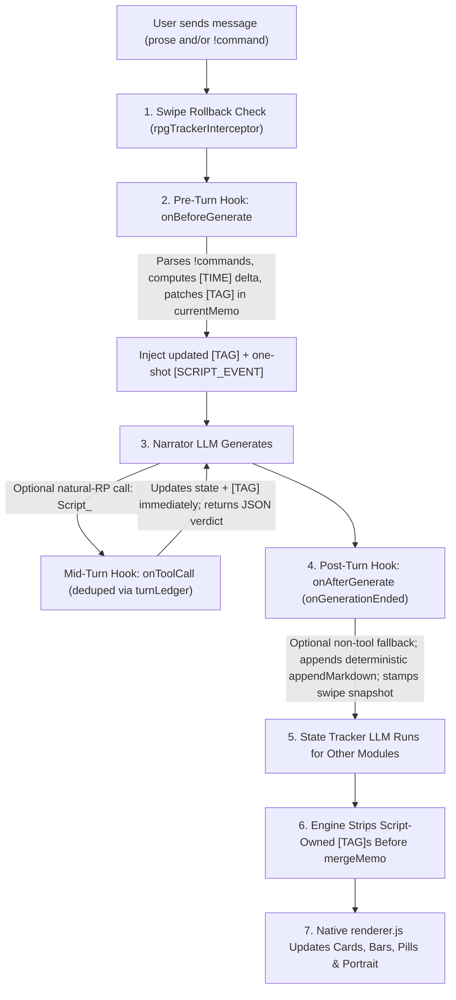

# Game Scripts

Game Scripts is a deterministic, sandboxed scripting subsystem built into `Combat-Multihog`. It lets character cards, campaigns, and custom RPG rulesets run real code alongside SillyTavern generation — resolving explicit `!commands`, passive `[TIME]` ticks, mid-turn Narrator tool calls, weighted progression math, and evolution portraits **deterministically** without suffering from the Narrator ↔ State Tracker chicken-and-egg lag.

Open it from **Settings → Scripts**.

---

## Table of Contents

1. [Why Game Scripts Exist](#why-game-scripts-exist)
2. [Architecture & Framework Integration](#architecture--framework-integration)
   - [Layered Design (Decoupled Core + Host Adapter)](#layered-design-decoupled-core--host-adapter)
   - [Turn Lifecycle & Dual Adjudication](#turn-lifecycle--dual-adjudication)
   - [State Tracker Isolation & Native HUD Rendering](#state-tracker-isolation--native-hud-rendering)
   - [Storage, Scoping & Character Auto-Binding](#storage-scoping--character-auto-binding)
   - [Multiple Scripts, Priority & Collisions](#multiple-scripts-priority--collisions)
   - [Persistence, Swipe Rollback & Cartridges](#persistence-swipe-rollback--cartridges)
   - [Sandboxing & Security Model](#sandboxing--security-model)
3. [Guide: Writing Your Own Scripts](#guide-writing-your-own-scripts)
   - [Quick Start in the Script Studio](#quick-start-in-the-script-studio)
   - [Canonical `.script.json` Schema](#canonical-scriptjson-schema)
   - [JavaScript Authoring Styles](#javascript-authoring-styles)
   - [Hook Signatures & Context (`ctx`) Reference](#hook-signatures--context-ctx-reference)
   - [Hook Return Fields](#hook-return-fields)
   - [Common Implementation Patterns](#common-implementation-patterns)
   - [Complete End-to-End Example](#complete-end-to-end-example)
   - [Testing, Debugging & Troubleshooting](#testing-debugging--troubleshooting)

---

## Why Game Scripts Exist

Prompt-only Game Systems (`<gm_section>` + `<tracker_module>`) rely on two separate LLM passes:

1. The Narrator generates prose using the **prior** turn's State Memo.
2. The State Tracker runs **after** the Narrator finishes (`GENERATION_ENDED`) to read the prose and update numbers.

For simple narrative counters that works well, but for stateful systems (e.g., character-raising simulators, resource/vitality drain matrices, multi-route weighted scoring, `!command` handlers, or exact evolution image recall), a two-pass LLM loop causes:
- **Chicken-and-egg deadlocks:** the Narrator waits for the State Tracker to unlock a stage, while the State Tracker waits for the Narrator to describe it.
- **Command blindness:** explicit `!commands` aren't evaluated before the Narrator responds.
- **Arithmetic & URL drift:** LLMs miscalculate coupled clamps or corrupt long image URLs.

Game Scripts solves all three by putting deterministic code in charge of state while keeping the Narrator in charge of prose.

---

## Architecture & Framework Integration

### Layered Design (Decoupled Core + Host Adapter)

The subsystem lives under `src/features/scripting/` and is intentionally split into two strict layers:

| Layer | Files | Responsibility |
| :--- | :--- | :--- |
| **Pure `core/`** *(zero SillyTavern, DOM, or Multihog imports)* | `src/features/scripting/core/script-schema.js`<br>`src/features/scripting/core/runner-registry.js`<br>`src/features/scripting/core/runner-js-worker.js`<br>`src/features/scripting/core/runner-js-node.js`<br>`src/features/scripting/core/script-engine.js`<br>`src/features/scripting/core/script-templates.js` | Portable `.script.json` schema, command parser, tool JSON-Schema compiler, pluggable language runners, sandboxed execution, turn orchestrator, deduplication ledger, starter templates. |
| **Host Adapter, Store & UI** | `src/features/scripting/script-store.js`<br>`src/features/scripting/script-host-adapter.js`<br>`src/features/scripting/script-ui.js`<br>`src/features/scripting/script-studio.js` | Settings catalog CRUD, per-chat/global/character-binding resolution, swipe snapshots, SillyTavern `registerFunctionTool` sync, `[TIME]` parsing, HUD card metadata/portraits, Settings tab & 4-tab Script Studio modal. |

Because `core/` communicates purely through JSON payloads and has zero host imports:
- Every core module and script runs directly under Node + Vitest (`npm test`).
- Future language runtimes (such as **Pyodide** in-browser Python in Phase 2) plug directly into `runner-registry.js` without changing the engine, store, or UI.
- The entire `core/` layer and all user `.script.json` files can be extracted into a standalone SillyTavern extension in the future by swapping out only the host adapter.

---

### Turn Lifecycle & Dual Adjudication

Game Scripts supports **both** explicit `!commands` and natural-language RP seamlessly on the same turn, governed by a per-turn execution ledger (`createTurnLedger`) so actions never double-fire.



Exact framework integration points:

1. **System Prompt Assembly (`index.js` → `buildSysprompt`):**
   Appends `buildActiveScriptsSyspromptBlock(settings, chatId)` — each enabled script's `gmPrompt` plus a brief reminder of its registered tool name and actions if not already mentioned.
2. **Pre-Turn Interception (`narrative-hooks.js` → `rpgTrackerInterceptor`):**
   - Calls `handleHostScriptSwipeRollback(lastAiMsg, settings)` right after `applyMemoSwipeRollback`.
   - Calls `runHostScriptsBeforeGenerate({ chat, lastUserMessage, settings })` **before** `settings.currentMemo` is serialized into `## TRACKER STATE 0 (Current)`.
   - Patches script-owned `[TAG]` blocks into `settings.currentMemo` immediately so the Narrator sees the fresh state on the exact same turn.
   - Optionally strips the raw `!command` line from the outgoing user message if `stripCommand` / `stripCommandFromPrompt` is enabled.
   - Appends any `promptInjection` wrapped in `[SCRIPT_EVENT]...[/SCRIPT_EVENT]` (including an automatic reminder not to re-invoke tools for commands already executed pre-turn).
3. **Mid-Turn Function Tool Calls (`script-host-adapter.js` → `syncScriptToolRegistrations`):**
   - Synchronized on boot, `CHAT_CHANGED`, `MESSAGE_SENT`, `GENERATION_STARTED`, and `GENERATION_ENDED`.
   - Registers **one dedicated SillyTavern tool per tool-enabled script** (e.g., `Script_SuccubusCompanion`) with a tight `action` enum and typed parameter schema compiled by `buildToolSchemaFromActions`.
   - When the Narrator calls the tool mid-response, `runScriptToolAction` validates against the active turn ledger:
     - **Pre-turn duplicate guard:** if `!prefix <action>` already ran pre-turn with matching (or empty) args — normalizing `-` and `_` (so `!succubus set-rule` matches `set_rule`) — the tool returns `{ status: 'already_handled' }` without mutating state twice.
     - **Mid-turn duplicate guard:** identical `(action, canonicalArgs)` calls in the same turn are deduplicated.
     - **Turn cap:** enforces `maxToolCallsPerTurn` (default `8`) to prevent runaway tool loops.
   - Otherwise, `onToolCall` mutates state, immediately updates `[TAG]` in `currentMemo` + HUD, queues any `appendMarkdown`, and returns `JSON.stringify(toolResult)` directly to the Narrator so it finishes the same reply with the exact outcome.
4. **Post-Turn Finalization (`narrative-hooks.js` → `onGenerationEnded`):**
   - Runs `runHostScriptsAfterGenerate` on valid, non-quiet active-character assistant replies before the State Tracker runs.
   - Passes `ctx.assistantMessage` and `ctx.turnLedger` so scripts targeting non-tool-calling models can optionally parse fallback prose markers only when `handledInPreTurn` and `handledInToolCall` are empty.
   - Deterministically appends deduplicated `appendMarkdown` snippets (such as evolution portrait Markdown images) onto `lastAiMsg.mes`, avoiding LLM URL typos.
   - Stamps pre-turn and post-turn snapshots onto `lastAiMsg.extra` (`rpgScriptRollback` / `rpgScriptResult` / `rpgScriptActiveSwipe`).

---

### State Tracker Isolation & Native HUD Rendering

To prevent the LLM State Tracker from ever overwriting or disagreeing with a script:
- **`memo-processor.js` (`buildModulesInstructionText`):** Calls `getClaimedScriptTags(settings, chatId, characterName)` and omits any stock or custom module whose uppercase tag is owned by an active script (saving tracker prompt tokens).
- **`index.js` (`runStateModelPass`):** Strips any `[TAG]...[/TAG]` block matching `getClaimedScriptTagsForActiveChat` from the State Tracker's output before `mergeMemo` (the same mechanism used to protect `[COMBAT]` during active Tactical/Traditional board encounters).
- **`renderer.js` (`renderSectionCard` & `renderTabModeView`):** Uses `registerScriptCardMetaResolver` registered by `initScriptHostAdapter()` to resolve each script-owned `[TAG]`'s `icon`, display `label`, and optional safe `portraitUrl` (rendered inside `.rt-script-card-portrait-wrap` at the top of the tracker card). Standard `Combat-Multihog` markers (`((BAR))`, `((BARGREEN))`, `((BARRED))`, `((PILLS))`, etc.) render natively with animations and theme support.

---

### Storage, Scoping & Character Auto-Binding

Script definitions and per-chat runtime states live on `extensionSettings.rpg_tracker` (protected from `saveChatState` / `loadChatState` clobbering via `CHAT_STATE_GLOBAL_UI_KEYS` in `src/state/settings.js`):

- `gameScriptsEnabled` (`boolean`, default `true`) — master enable switch.
- `gameScriptDatabase` (`Array<ScriptDefinition>`) — global library of script definitions.
- `gameScriptOrder` (`Array<string>`) — ordered script IDs defining execution priority.
- `gameScriptStatesByChat` (`{ [chatId]: { [scriptId]: { state, portraitUrl, lastUpdatedAt, lastError } } }`) — isolated per-chat runtime state.
- `chatStates[chatId].setup.gameScriptStates` (`{ [scriptId]: boolean }`) — explicit per-chat activation overrides managed by `src/state/chat-setup.js`.

**Activation resolution precedence** (`isScriptEnabledForChat` in `script-store.js`):
1. If `settings.gameScriptsEnabled === false` → **disabled** (`disabled_master`).
2. If an explicit per-chat boolean exists in `chatStates[chatId].setup.gameScriptStates[script.id]` → **uses that override** (`override`). This lets you disable a global or character-bound script in one specific chat, or enable a chat-scoped script manually.
3. If `script.scope === 'global'` → active when `script.globalEnabled === true` (`global`).
4. If `script.scope === 'character'` → active when the active character's name matches any entry in `script.boundCharacters` (trimmed, case-insensitive) (`character`).
5. If `script.scope === 'chat'` → inactive by default until toggled on for that chat (`chat`).

---

### Multiple Scripts, Priority & Collisions

Multiple scripts can run together in the same chat (e.g., a character-bound companion script + a global survival/weather script):
- **Execution order:** Scripts run sequentially in `gameScriptOrder` priority order. Each script receives a read-only `ctx.otherScripts` snapshot of other active scripts' states (reflecting updates made earlier in the same turn).
- **Error isolation:** Each script runs inside its own `try/catch` and timeout boundary. If Script A throws or times out, its error is saved to `lastError` (visible in **Settings → Scripts**) while Script B and the rest of the chat turn continue unaffected.
- **Collision detection (`detectScriptCollisions`):** Automatically checks active scripts for duplicate `trackerTag`, duplicate `commandPrefix` (case-insensitive), or duplicate `toolName`, surfacing a warning banner in the **Scripts** settings tab.

---

### Persistence, Swipe Rollback & Cartridges

- **Swipe / Regenerate Rollback:** `script-store.js` mirrors `applyMemoSwipeRollback` using `rpgScriptRollback`, `rpgScriptResult`, and `rpgScriptActiveSwipe` on `lastAiMsg.extra`. Swiping an assistant reply restores exact pre-turn script states (including mid-turn tool mutations) and re-renders active `[TAG]` blocks into `currentMemo`.
- **Chat Lifecycle:**
  - `CHAT_RENAMED` (`src/features/chat/chat-rename-migrate.js`) migrates `gameScriptStatesByChat[oldId]` → `gameScriptStatesByChat[newId]`.
  - `CHAT_DELETED` (`src/features/chat/deleted-chat-data.js`) cleans up `gameScriptStatesByChat[chatId]`.
  - Campaign Branching (`src/features/chat/branch-campaign-utils.js`) deep-clones `gameScriptStatesByChat[oldId]` into the new branch chat.
- **Game Cartridges:** `src/state/factory-and-diff.js` includes `gameScriptsEnabled`, `gameScriptDatabase`, and `gameScriptOrder` under the **Game Scripts** cartridge group for full export and selective import.

---

### Sandboxing & Security Model

Imported scripts can come from third-party creators, so execution is strictly sandboxed:
- **Browser Web Worker (`runner-js-worker.js`):** Each hook runs in an ephemeral `Blob` Web Worker that is terminated after completion. Inside the user script wrapper scope, `fetch`, `XMLHttpRequest`, `importScripts`, `WebSocket`, `EventSource`, `indexedDB`, `caches`, `navigator`, `self`, `globalThis`, `postMessage`, `close`, `Worker`, and `SharedWorker` are shadowed as `undefined` — preventing DOM access, SillyTavern settings access, or network exfiltration.
- **Hard Timeout (`DEFAULT_SCRIPT_TIMEOUT_MS = 1500`):** Infinite loops (e.g., `while (true) {}`) or stalled async promises are terminated cleanly (`timedOut: true`) without freezing SillyTavern.
- **Node VM Test Sandbox (`runner-js-node.js`):** Dynamically loads `node:vm` only in Node/Vitest (never parsed as a static import in browsers), creates a null-prototype context with `codeGeneration: { strings: false, wasm: false }`, and blocks host globals (`process`, `require`, `Buffer`, `fetch`, `globalThis`).
- **JSON Boundary & URL Sanitization:** All hook inputs/outputs round-trip through JSON cloning to prevent prototype leakage. `portraitUrl` is allowlisted to `https://`, `http://`, `/`, or `data:image/` (`javascript:`, `vbscript:`, and `data:text/html` are rejected). `console.log`/`info`/`warn`/`error` calls are captured into `logs[]` (capped at 100 entries).

---

## Guide: Writing Your Own Scripts

### Quick Start in the Script Studio

1. Open **Settings → Scripts** and make sure **Enable Game Scripts Engine** is checked.
2. Click **+ New Script** (or **Import `.json`** to load an existing file like `tests/fixtures/my-succubus-companion.script.json`).
3. Work across the 4 tabs of the **Structured Script Studio**:
   - **Setup & Binding:** Give your script a Name, Icon, Scope (`chat`, `global`, or `character` with **Add Current Character**), optional Tracker `[TAG]` (e.g., `SANITY`), optional `!commandPrefix` (e.g., `!sanity`), and toggle **Enable Narrator Tool Call**.
   - **Narrator Prompt & Actions:** Write concise `<tag>...</tag>` instructions for the Narrator and add tool actions using the row-based **Action Builder** (no manual JSON Schema writing needed — the live schema preview updates automatically).
   - **Code & Templates:** Pick a starter template (*Blank*, *Time-Decay Meter*, *Command + Tool Companion*, or *Stage & Route Progression*), insert common helpers with the **Pattern Snippet** buttons, and click **Validate Script** to test syntax + `initState()`.
   - **Live Test Sandbox:** Simulate `!commands`, `[TIME]` jumps (`+Minutes` / Day Changed), tool calls, and post-turn replies right inside the modal — inspecting the mutated State JSON, rendered HUD card preview, prompt injection, and console logs without affecting your active chat.
4. Click **Save Script**. You can inspect, manually edit, or reset live chat state at any time via the **Live State** button on the script row.

---

### Canonical `.script.json` Schema

Scripts export and import as portable single-file JSON documents (`schemaVersion: 1`):

```json
{
  "schemaVersion": 1,
  "id": "hearth_companion",
  "name": "Hearth Companion",
  "icon": "🔥",
  "description": "Tracks warmth, trust, and milestones for a campfire companion.",
  "lang": "js",
  "scope": "character",
  "boundCharacters": ["Lyra"],
  "globalEnabled": false,
  "trackerTag": "HEARTH_COMPANION",
  "commandPrefix": "!hearth",
  "stripCommandFromPrompt": false,
  "toolEnabled": true,
  "toolName": "Script_HearthCompanion",
  "toolDescription": "Update companion warmth, trust, or milestones during natural RP.",
  "toolActions": [
    {
      "name": "tend_fire",
      "description": "Stoke the fire or share warmth with the companion.",
      "params": [
        {
          "name": "intensity",
          "type": "number",
          "required": false,
          "description": "1 (small spark) to 5 (roaring hearth)"
        }
      ]
    },
    {
      "name": "comfort",
      "description": "Reassure or comfort the companion.",
      "params": [
        {
          "name": "kind",
          "type": "string",
          "enum": ["words", "embrace", "gift"],
          "required": true,
          "description": "Type of comfort offered."
        }
      ]
    }
  ],
  "gmPrompt": "<hearth_companion>\nRead [HEARTH_COMPANION] as absolute truth; never invent numbers.\nWhen {{user}} tends the fire or comforts her in natural prose without a !hearth command, call Script_HearthCompanion mid-turn.\n</hearth_companion>",
  "code": "function initState() { ... }"
}
```

#### Field Reference

| Field | Required | Notes |
| :--- | :---: | :--- |
| `schemaVersion` | Yes | Always `1`. |
| `id` | Auto | Sanitized to lowercase `snake_case` (`[a-z0-9_]+`). Derived from `name` if omitted. |
| `name` | Yes | Human-readable script title (also used as HUD card label fallback). |
| `icon` | No | Emoji or icon string (default `📜`), used on the HUD card header. |
| `lang` | No | `'js'` (default). `'python'` is reserved for Phase 2 Pyodide support. |
| `scope` | No | `'chat'` (default), `'global'`, or `'character'`. |
| `boundCharacters` | No | Array of character names for `scope: 'character'` (case-insensitive match). |
| `globalEnabled` | No | When `scope === 'global'`, whether enabled by default across all chats. |
| `trackerTag` | No | Claimed `[TAG]` block normalized to `UPPER_SNAKE_CASE`. Excluded from State Tracker LLM automatically. |
| `commandPrefix` | No | Leading `!` prefix (e.g., `!succubus`, `!hearth`). Blank disables command parsing. |
| `stripCommandFromPrompt` | No | If `true`, removes matched `!command` lines from the user message before sending to the Narrator. |
| `toolEnabled` | No | If `true` and `toolActions.length > 0`, registers a SillyTavern function tool for this script. |
| `toolName` | Auto | Must match `^[A-Za-z][A-Za-z0-9_]{1,63}$`; defaults to `Script_<PascalCaseName>`. |
| `toolActions` | No | Array of `{ name, description, params: [{ name, type, required, enum?, description }] }`. Param `type` is `'string' \| 'number' \| 'boolean'`. |
| `gmPrompt` | No | Narrator system-prompt instructions injected into `buildSysprompt` while active. |
| `code` | Yes | JavaScript source implementing the script's hooks. |

---

### JavaScript Authoring Styles

The runner supports **all three** common JavaScript styles, and hooks may be synchronous or `async`:

**1. Top-level named functions (recommended — cleanest in the editor):**
```js
function initState(ctx) {
    return { trust: 10, warmth: 50 };
}

function onBeforeGenerate(state, ctx) {
    return { state };
}

function onToolCall(state, call, ctx) {
    return { state, toolResult: { ok: true } };
}

function renderMemo(state, ctx) {
    return `Warmth ((BAR)) ${state.warmth}/100`;
}
```

**2. Explicit `return { ... }` object:**
```js
return {
    initState(ctx) { return { trust: 10 }; },
    renderMemo(state) { return `Trust: ${state.trust}`; },
};
```

**3. CommonJS `module.exports` / `exports`:**
```js
module.exports = {
    initState() { return { trust: 10 }; },
    renderMemo(state) { return `Trust: ${state.trust}`; },
};
```

All hooks are optional — if your script omits `onAfterGenerate` or `onToolCall`, the engine skips it without error.

---

### Hook Signatures & Context (`ctx`) Reference

| Hook | Signature | When It Runs |
| :--- | :--- | :--- |
| `initState` | `initState(ctx) → initialStateObject` | Once when a chat has no saved state for this script (or after clicking **Reset State**). |
| `onBeforeGenerate` | `onBeforeGenerate(state, ctx) → result` | Pre-turn inside `rpgTrackerInterceptor`, **before** the Narrator LLM sees `currentMemo`. |
| `onToolCall` | `onToolCall(state, { action, args }, ctx) → result` | Mid-turn when the Narrator invokes this script's registered SillyTavern tool. |
| `onAfterGenerate` | `onAfterGenerate(state, ctx) → result` | Post-turn inside `onGenerationEnded` after the assistant finishes replying. |
| `renderMemo` | `renderMemo(state, ctx) → string \| { memoBlock }` | Automatically called whenever `trackerTag` is set and a hook didn't return an explicit `memoBlock`. |

#### `ctx` Payload Properties

Every hook receives a clean, JSON-cloned `ctx` object:

```js
{
  userMessage: "!hearth comfort: words\nI hand her a warm mug.",
  assistantMessage: "", // populated in onAfterGenerate
  command: {            // null if no line matched commandPrefix
    prefix: "!hearth",
    subcommand: "comfort", // lowercased first token (trailing ':' stripped)
    rawArgs: "words",      // trimmed remainder of the command line
    fullMatch: "!hearth comfort: words",
    line: "!hearth comfort: words",
    strippedMessage: "I hand her a warm mug."
  },
  memoBlocks: {         // read-only map of parsed [TAG] -> body from currentMemo
    TIME: "08:30 AM, Day 2",
    LOCATION: "Storm Cabin"
  },
  time: {               // pre-parsed from [TIME] vs prior memo
    current: "08:30 AM, Day 2",
    prior: "07:45 AM, Day 2",
    currentMinutes: 1950,
    priorMinutes: 1905,
    deltaMinutes: 45,   // >= 0 elapsed in-world minutes
    dayChanged: false   // true when Math.floor(min/1440) advanced
  },
  character: { name: "Lyra" },
  user: { name: "Alex" },
  chatId: "Lyra - 2026-11-24",
  otherScripts: {       // read-only state snapshots of other active scripts
    weather_engine: { weather: "Storm", tempC: 4 }
  },
  turnLedger: {         // read-only summary of actions already executed this turn
    handledInPreTurn: { hearth_companion: [{ subcommand: "comfort", rawArgs: "words", normalizedAction: "comfort" }] },
    handledInToolCall: {},
    toolCallCount: 0,
    maxToolCallsPerTurn: 8
  }
}
```

---

### Hook Return Fields

`onBeforeGenerate`, `onToolCall`, and `onAfterGenerate` return a plain JSON object where every field is optional:

| Return Field | Type | Behavior |
| :--- | :--- | :--- |
| `state` | `object` | Persisted as the script's new per-chat state. Omit to leave state unchanged. |
| `memoBlock` | `string` | Overrides `renderMemo(state)` for this turn's `[TAG]` body. Pass `""` to clear the block. |
| `promptInjection` | `string` | One-shot directive injected into `[SCRIPT_EVENT]` for the Narrator on **this turn only**. |
| `toolResult` | `any` (JSON) | Returned verbatim (JSON-stringified) to the Narrator as the tool response in `onToolCall`. |
| `stripCommand` | `boolean` | Strips the matched `!command` line from the outgoing user message for this turn. |
| `portraitUrl` | `string` | Sets (or clears with `""`) the `.rt-script-card-portrait` image shown at the top of the HUD card. Must start with `https://`, `http://`, `/`, or `data:image/`. |
| `appendMarkdown` | `string` | Deterministically appended to the assistant's finished chat reply on `GENERATION_ENDED` (deduplicated so it never repeats if already present). Ideal for one-shot evolution portraits (``). |

---

### Common Implementation Patterns

#### 1. Share One Action Reducer Between `!commands` and Tool Calls
Never duplicate game math between `onBeforeGenerate` and `onToolCall`. Write one pure `applyAction(state, action, args)` helper and call it from both hooks:

```js
function clamp(n, min, max) {
    return Math.max(min, Math.min(max, Math.round(Number(n) || 0)));
}

function applyAction(state, action, args) {
    const next = Object.assign({}, state);
    const events = [];

    if (action === 'tend_fire') {
        const gain = clamp(args?.intensity || 2, 1, 5) * 8;
        next.warmth = clamp(next.warmth + gain, 0, 100);
        events.push(`Stoked the hearth (+${gain} Warmth -> ${next.warmth}/100).`);
    } else if (action === 'comfort') {
        const kind = String(args?.kind || 'words').toLowerCase();
        const trustGain = kind === 'gift' ? 10 : kind === 'embrace' ? 8 : 5;
        next.trust = clamp(next.trust + trustGain, 0, 100);
        events.push(`Offered ${kind} (+${trustGain} Trust -> ${next.trust}/100).`);
    }

    return { state: next, summary: events.join(' ') };
}
```

#### 2. Passive `[TIME]` Decay & Day Rollovers
Use `ctx.time.deltaMinutes` and `ctx.time.dayChanged` inside `onBeforeGenerate` so meters tick automatically whenever `[TIME]` advances:

```js
if (ctx.time && ctx.time.deltaMinutes > 0) {
    const drain = Math.floor(ctx.time.deltaMinutes / 15);
    if (drain > 0) {
        next.warmth = clamp(next.warmth - drain, 0, 100);
    }
}
if (ctx.time && ctx.time.dayChanged) {
    next.day += 1;
    if (!next.caredToday) next.neglectDays += 1;
    next.caredToday = false;
}
```

#### 3. Native HUD Rendering With `((BAR))` and `((PILLS))`
Return lines formatted with `Combat-Multihog`'s built-in renderer markers from `renderMemo(state)`:

```js
function renderMemo(state) {
    const warmthTier = state.warmth >= 70 ? 'Cozy' : state.warmth >= 30 ? 'Cooling' : 'Freezing';
    const trustTier = state.trust >= 75 ? 'Devoted' : state.trust >= 40 ? 'Warm' : 'Guarded';
    return [
        `🔥 Companion: ${state.name} | Stage: ${state.stage} | Day ${state.day}`,
        `Warmth ((BAR)) ${state.warmth}/100`,
        `Trust ((BARGREEN)) ${state.trust}/100`,
        `Status: ((PILLS)) ${state.stage}, ${warmthTier}, ${trustTier}`,
    ].join('\n');
}
```

#### 4. One-Shot Stage Transitions & Typo-Proof Evolution Images
Track shown images in `state.shownImages` so `appendMarkdown` fires **once** on unlock and never spams subsequent turns:

```js
const STAGE_IMAGES = {
    Bonded: 'https://example.com/portraits/bonded.webp',
};

let appendMarkdown = '';
let portraitUrl;
if (next.stage === 'Awakened' && next.trust >= 50) {
    next.stage = 'Bonded';
    const imgKey = 'Bonded';
    const url = STAGE_IMAGES[imgKey];
    if (url) {
        portraitUrl = url;
        if (!next.shownImages.includes(imgKey)) {
            next.shownImages = next.shownImages.concat([imgKey]);
            appendMarkdown = ``;
        }
    }
}
```

#### 5. Graceful Non-Tool Fallback in `onAfterGenerate`
If a user runs a model without function calling, check `ctx.turnLedger` in `onAfterGenerate` so fallback parsing only runs when neither a `!command` nor a tool call already handled the turn:

```js
function onAfterGenerate(state, ctx) {
    const pre = ctx.turnLedger?.handledInPreTurn?.hearth_companion || [];
    const tools = ctx.turnLedger?.handledInToolCall?.hearth_companion || [];
    if (pre.length > 0 || tools.length > 0) {
        return { state }; // Already adjudicated this turn
    }
    if (/\*\(Hearth:\s*stoked\)\*/i.test(ctx.assistantMessage || '')) {
        const res = applyAction(state, 'tend_fire', { intensity: 2 });
        return { state: res.state };
    }
    return { state };
}
```

#### 6. Writing a Good `gmPrompt`
Keep `<gm_section>` short and clear about authority:
- State that `[YOUR_TAG]` in the State Memo is script-owned law — never restate or invent numbers.
- Tell the Narrator **when** to call `Script_<YourTool>` (natural RP actions when no `!command` was used).
- Tell the Narrator **not** to re-call the tool when `[SCRIPT_EVENT]` reports a pre-turn command already executed.
- Never ask the LLM to paste long image URLs manually if your script returns `appendMarkdown` — just tell it to narrate the visible shift.

---

### Complete End-to-End Example

Below is a minimal, fully working script you can paste straight into the **Code & Templates** tab of Script Studio (with `trackerTag: "HEARTH_COMPANION"`, `commandPrefix: "!hearth"`, `toolEnabled: true`, and actions `tend_fire` + `comfort`):

```js
function clamp(n, min, max) {
    return Math.max(min, Math.min(max, Math.round(Number(n) || 0)));
}

function initState() {
    return {
        name: 'Lyra',
        stage: 'Stranger',
        warmth: 45,
        trust: 10,
        day: 1,
        shownMilestones: [],
    };
}

function evaluateMilestones(state) {
    const notes = [];
    if (state.stage === 'Stranger' && state.trust >= 35) {
        state.stage = 'Trusted';
        notes.push('STAGE SHIFT -> Trusted: narrate her posture relaxing and speaking with genuine warmth.');
    } else if (state.stage === 'Trusted' && state.trust >= 75) {
        state.stage = 'Bonded';
        notes.push('STAGE SHIFT -> Bonded: narrate a quiet, unmistakable vow of loyalty.');
    }
    return notes;
}

function applyAction(state, action, args) {
    const next = Object.assign({}, state);
    const notes = [];

    if (action === 'tend_fire') {
        const gain = clamp(args?.intensity || 2, 1, 5) * 8;
        next.warmth = clamp(next.warmth + gain, 0, 100);
        notes.push(`Hearth tended (+${gain} Warmth -> ${next.warmth}/100).`);
    } else if (action === 'comfort') {
        const kind = String(args?.kind || 'words').toLowerCase();
        const gain = kind === 'gift' ? 10 : kind === 'embrace' ? 8 : 5;
        next.trust = clamp(next.trust + gain, 0, 100);
        next.warmth = clamp(next.warmth + 4, 0, 100);
        notes.push(`Comforted via ${kind} (+${gain} Trust -> ${next.trust}/100).`);
    } else if (action === 'status') {
        notes.push(`Current status: Stage=${next.stage}, Warmth=${next.warmth}/100, Trust=${next.trust}/100.`);
    } else {
        notes.push(`Unknown action "${action}".`);
    }

    const milestoneNotes = evaluateMilestones(next);
    return { state: next, summary: notes.concat(milestoneNotes).join(' ') };
}

function onBeforeGenerate(state, ctx) {
    let next = Object.assign({}, state);
    const notes = [];

    if (ctx.time && ctx.time.deltaMinutes > 0) {
        const decay = Math.floor(ctx.time.deltaMinutes / 15);
        if (decay > 0) next.warmth = clamp(next.warmth - decay, 0, 100);
    }
    if (ctx.time && ctx.time.dayChanged) {
        next.day += 1;
    }

    if (ctx.command) {
        const sub = ctx.command.subcommand;
        const arg = ctx.command.rawArgs;
        const args = sub === 'tend_fire' || sub === 'tend'
            ? { intensity: Number(arg) || 2 }
            : sub === 'comfort'
                ? { kind: arg || 'words' }
                : {};
        const actionName = sub === 'tend' ? 'tend_fire' : sub;
        const res = applyAction(next, actionName, args);
        next = res.state;
        notes.push(res.summary);
    }

    return {
        state: next,
        promptInjection: notes.join('\n'),
    };
}

function onToolCall(state, call) {
    const res = applyAction(state, call.action, call.args || {});
    return {
        state: res.state,
        toolResult: {
            ok: true,
            summary: res.summary,
            stage: res.state.stage,
            warmth: res.state.warmth,
            trust: res.state.trust,
        },
    };
}

function renderMemo(state) {
    const tier = state.warmth >= 70 ? 'Cozy' : state.warmth >= 30 ? 'Cooling' : 'Cold';
    return [
        `🔥 ${state.name} | Stage: ${state.stage} | Day ${state.day}`,
        `Warmth ((BAR)) ${state.warmth}/100`,
        `Trust ((BARGREEN)) ${state.trust}/100`,
        `Status: ((PILLS)) ${state.stage}, ${tier}`,
    ].join('\n');
}
```

For a full production-scale example exercising 20+ `!commands`, 10 tool actions, a mucosal drain × protection matrix, 10-route weighted scoring, monotone route locking, neglect branches, and deterministic portrait/evolution images, inspect [`tests/fixtures/my-succubus-companion.script.json`](../tests/fixtures/my-succubus-companion.script.json).

---

### Testing, Debugging & Troubleshooting

#### Inside SillyTavern
- **Live Test Sandbox (Script Studio → Tab 4):** Test `initState`, pre-turn `!commands` + `[TIME]` deltas, mid-turn tool calls, and post-turn hooks with live State JSON, HUD card preview, and `console.log` output before enabling the script in a real campaign.
- **Live State Inspector (Settings → Scripts → Live State):** Inspect or manually edit a running chat's JSON state mid-campaign, or reset it cleanly back to `initState()`.

#### Automated Unit Tests (Vitest)
Because `core/` is pure Node-compatible ESM, you can test any exported `.script.json` directly with `vitest`:

```js
import { readFileSync } from 'node:fs';
import { describe, expect, it } from 'vitest';
import { parseScriptFromJson } from '../src/features/scripting/core/script-schema.js';
import { createTurnLedger, runScriptsBeforeGenerate, runScriptToolAction } from '../src/features/scripting/core/script-engine.js';

describe('my custom script', () => {
    it('advances state cleanly', async () => {
        const parsed = parseScriptFromJson(readFileSync('path/to/my.script.json', 'utf8'));
        expect(parsed.ok).toBe(true);

        const ledger = createTurnLedger();
        const pre = await runScriptsBeforeGenerate([parsed.script], {}, { userMessage: '!hearth comfort: embrace' }, ledger);
        expect(pre.errors).toEqual([]);
        expect(pre.updatedStates[parsed.script.id].trust).toBeGreaterThan(10);
    });
});
```

#### Common Pitfalls
- **Non-JSON values in `state`:** Never store functions, `Set`, `Map`, `Date`, or `RegExp` instances directly in `state` — everything is JSON-cloned across the Worker boundary. Use plain objects, arrays, numbers, strings, and booleans.
- **Timeout (`timedOut: true`):** Scripts must finish within 1,500 ms. Avoid unbounded `while` loops.
- **Portrait URL silently ignored:** `portraitUrl` only accepts `https://`, `http://`, `/`, or `data:image/` URLs.
- **Tool doesn't appear for the Narrator:** Verify **Enable Narrator Tool Call** is checked, at least one action is defined in **Action Builder**, your SillyTavern API uses Chat Completion with function calling enabled, and no collision warning appears in **Settings → Scripts**.
- **State Tracker overwriting your block:** Ensure `trackerTag` matches the exact `[TAG]` name your script renders (case-insensitive, normalized to `UPPER_SNAKE_CASE`).
